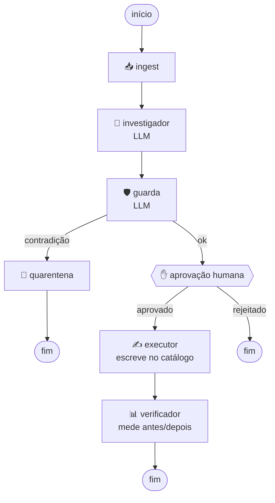
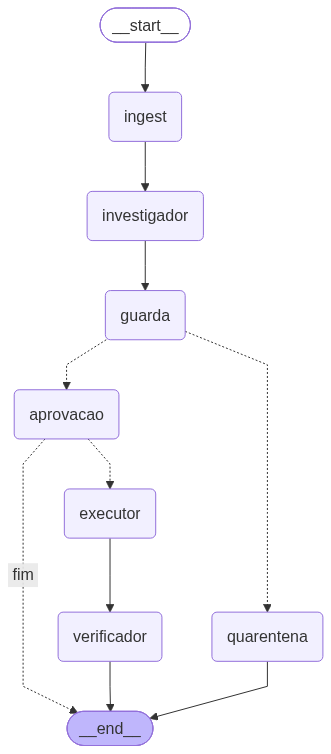

# 🧭 Venditus

> **Corrige o catálogo pela voz do cliente. E sabe quando não corrigir.**

*Venditus* — do latim, "vendido". O que o catálogo deixa de dizer, o cliente já disse.

Demo desenvolvida no contexto do hackathon **deco — Agents for Commerce** · 2026.

**Demo com dados sintéticos:** volumes, produtos e devoluções apresentados abaixo vêm de `back/src/venditus/seed.py`. Não são clientes, vendas ou devoluções observados em produção. As decisões e indicadores das tabelas descrevem o cenário esperado da demonstração.

---

## 🎯 O problema

**Quando o catálogo não fala a língua do cliente**, podem surgir problemas antes e depois da compra. O cenário de exemplo conecta esses dois sinais:

**🔍 Antes da compra** — o cliente busca *"tênis impermeável"*. A loja **tem** o produto, mas a palavra só existe no texto livre da descrição, não como atributo estruturado. A busca retorna zero. Ele sai calado, e a loja nunca fica sabendo que perdeu a venda.

**📦 Depois da compra** — o cliente compra uma air fryer 220V porque a página não informava a voltagem. Devolve. Semana que vem, outro cliente cai no mesmo buraco.

É **o mesmo defeito de atributo**, visto de dois lados.

---

## 💡 A ideia

Existem dois sinais na loja, e cada um enxerga metade do problema.

#### 🔍 A busca indica uma oportunidade — mas não confirma o atributo

O cenário usa **340 buscas sintéticas** por *"tênis impermeável"* sem resultados. Esse volume alimenta uma estimativa de oportunidade; não mede vendas perdidas.

O que a busca **não** sabe: se o tênis é mesmo impermeável. Isso ela só pode inferir da descrição — um texto escrito pelo marketing.

#### 📦 A devolução acrescenta o relato de uso — mas não mede a oportunidade

Oito pessoas que compraram a capa de chuva escreveram que ela molha. No cenário sintético, esse é o sinal atribuído ao pós-venda; não é um depoimento real coletado.

O que a devolução **não** sabe: quantas vendas estão sendo perdidas por causa disso, nem onde procurar a próxima. Os oito relatos sintéticos fazem parte do histórico de devoluções, não de um acompanhamento real de clientes.

#### 🧩 Por que combinar os sinais neste exemplo

No exemplo, considerar apenas o catálogo pode levar à mesma proposta para **os dois** produtos. O histórico sintético de devoluções acrescenta a contradição que falta para a capa de chuva.

O fluxo combina esses sinais para **propor uma correção ou recusá-la quando encontra uma contradição**.

### Cenário sintético de demonstração

Dois produtos fictícios ilustram o problema de atributo:

- **`SKU-4471` — Tênis Trilha Alpha** · descrição afirma ter membrana impermeável · atributo **vazio**
- **`SKU-8802` — Capa de Chuva Nimbus** · descrição menciona repelência à água · devoluções sintéticas relatam entrada de água · atributo **vazio**

Sinal de entrada:

```
"tênis impermeável"          340 buscas/mês   →  0 resultados
"capa de chuva impermeável"  128 buscas/mês   →  0 resultados
```

**Para o diagnóstico, os dois casos são idênticos.** Produto existe, descrição sustenta o termo, atributo faltando, busca falha. Mesma causa, mesma proposta de correção.

O que os separa está no pós-venda:

| | 🥾 SKU-4471 | 🧥 SKU-8802 |
|---|---|---|
| Devoluções em 90 dias | 3 | 11 |
| Falando de água | **0** | **8** |
| Decisão esperada do agente | ✅ **escreve** | 🛑 **recusa** |
| Resultado esperado | busca passa de 0 → 1 produto | vai para qualidade, **nada é escrito** |

### 🛑 Uma busca que considera apenas o catálogo

No cenário de exemplo, uma busca que considera apenas o catálogo encontra dois termos sem resultado e textos sobre impermeabilidade ou repelência à água. Sem consultar o pós-venda, ela não dispõe da contradição usada pelo guarda para recusar a segunda correção. Esse contraste descreve o cenário, sem caracterizar todas as ferramentas de busca do mercado.

> **Os dois casos entram idênticos no sistema. Só um deveria sair escrito.
> A diferença só existe se você ler os dois lados.**

---

## 🧠 Como funciona



Sete nós, **dois com LLM** (`investigador` e `guarda`). Os outros cinco são determinísticos — não colocamos modelo onde não é preciso.

O Mermaid representa os caminhos de `back/src/venditus/graph.py`, incluindo o encerramento após rejeição humana. A imagem abaixo é uma ilustração de arquitetura; para consultar as rotas de decisão, use o Mermaid e o código.

<p align="center">
  
</p>

Há roteamento condicional no `guarda` e na aprovação humana: uma aprovação segue ao `executor`; uma rejeição encerra o fluxo sem passar por esse nó. Para regenerar a imagem, execute `python scripts/gerar_diagrama.py` a partir de `back/`, com o ambiente Python do backend preparado.

**A aresta `guarda → quarentena` é o produto.** Quando o pós-venda contradiz a correção proposta, o caminho até a escrita simplesmente **não existe** — não é uma sugestão ao modelo, é topologia do grafo.

E nada é escrito sem **aprovação humana**. A escrita mora num nó posterior ao ponto de interrupção e é idempotente, porque retomar de uma pausa re-executa o nó inteiro.

---

## 📊 Indicadores do cenário de demonstração

| Indicador | Uso no cenário sintético |
|---|---|
| 🔍 Resultados da busca | `0 → 1` produto é o resultado esperado após a correção aprovada |
| 🏷️ Cobertura de atributo | Compara o catálogo antes e depois da correção |
| 💰 Oportunidade financeira estimada | `volume × conversão × ticket médio`, com premissas sintéticas; não é receita medida |
| 🛡️ Taxa de bloqueio do guarda | Proporção de correções recusadas entre os casos processados |
| 📉 Taxa de devolução por SKU | Avaliação futura depende de integração e acompanhamento de dados reais de pós-venda |

A **taxa de bloqueio** resume recusas nos casos processados pela demo. Os volumes, produtos e devoluções são sintéticos e não permitem estimar eficácia em produção.

### Contexto de negócio

O cenário explora buscas sem resultado e devoluções como sinais para revisão de catálogo. As estimativas financeiras dependem das premissas do exemplo; não representam impacto comercial medido.

---

## 🚀 Rodando

**Ambiente de referência:** Python **3.12** · Node **22+**. O manifesto backend declara Python >=3.11.

Confira a versão do interpretador selecionado na sua máquina antes de criar o ambiente virtual.

Há **quatro níveis, de 0 a 3**: testes, terminal, interface e integração opcional com Shopify. O nível 2 usa o catálogo em memória quando não há credenciais Shopify.

---

### Nível 0 — suíte de testes

```powershell
cd back
python -m venv .venv
.\.venv\Scripts\pip.exe install -e ".[dev]"
.\.venv\Scripts\python.exe -c "import venditus"   # tem que passar sem erro
.\.venv\Scripts\pytest.exe -v
```

<details>
<summary>macOS / Linux</summary>

```bash
cd back
python3 -m venv .venv
./.venv/bin/pip install -e ".[dev]"
./.venv/bin/python -c "import venditus"
./.venv/bin/pytest -v
```
</details>

A suíte de backend fica em `back/tests/`, com dublês em `back/tests/fakes.py` e testes de grafo, modelos e adapters.

Para selecionar os cenários de bloqueio e idempotência:

```powershell
.\.venv\Scripts\pytest.exe -v -k "caminho_bloqueado or idempotente"
```

| Teste | Comportamento esperado |
|---|---|
| `test_caminho_bloqueado_nao_escreve` | o guarda impede a escrita quando o pós-venda contradiz |
| `test_executor_e_idempotente` | retomar a aprovação não duplica a escrita |

> ⚠️ Se `import venditus` falhar com `ModuleNotFoundError`, a instalação
> editável pode não estar disponível no interpretador selecionado. Tente
> `.\.venv\Scripts\pip.exe install -e . --force-reinstall --no-deps` e confirme
> que surgiu `_editable_impl_venditus.pth` em `.venv/Lib/site-packages`.
> A configuração de `pythonpath` do pytest pode mascarar um problema na instalação editável; confira também o import fora da suíte.

---

### Nível 1 — a demo pelo terminal · só a chave da OpenAI

A partir da raiz do repositório, crie `back/.env`:

```env
OPENAI_API_KEY=<sua-chave>
```

**Sem credenciais da Shopify o projeto usa o catálogo em memória
automaticamente** — e ele já contém os dois produtos do caso. Não precisa de
loja nenhuma.

```powershell
cd back
.\.venv\Scripts\python.exe scripts\rodar_demo.py
```

O script executa os dois casos e imprime o veredito, usando chamadas reais ao modelo. O custo depende do modelo, consumo e preços vigentes.

---

### Nível 2 — a interface · a demo completa

**Terminal 1 — a partir da raiz, backend:**

```powershell
cd back
.\.venv\Scripts\langgraph.exe dev --no-browser --port 2024
```

**Terminal 2 — a partir da raiz, front:**

```powershell
cd front
npm install
npm run dev
```

Abra **`http://localhost:5173`**. É a única URL que você abre — o front fala
com o backend por um proxy, então não há CORS para configurar.

<details>
<summary>macOS / Linux — backend</summary>

```bash
cd back
./.venv/bin/langgraph dev --no-browser --port 2024
```
</details>

> ⚠️ Chame sempre o `langgraph` **de dentro do venv**. Se houver um `langgraph`
> global no PATH, o servidor sobe no Python errado, responde `200` em `/ok`, e
> só quebra quando um run executa — com um `ModuleNotFoundError` que não diz
> qual módulo.

#### O que clicar

| # | ação | o que deve acontecer |
|---|---|---|
| 1 | **tênis impermeável** → *Aprovar* | os seis passos acendem; a busca vai de **0 → 1** |
| 2 | **capa de chuva impermeável** | o passo *"Audita as devoluções"* fica **vermelho** e os seguintes são riscados; aparecem **as 11 devoluções** que o guarda leu |
| 3 | olhe os indicadores no topo | **1 de 2 correções recusadas** |

A duração e as respostas de cada caso dependem do ambiente e das chamadas ao modelo.

#### Testes do front

Em outro terminal, a partir da raiz do repositório:

```powershell
cd front
npm test        # executa a suíte Vitest
```

---

### Nível 3 — contra uma loja Shopify real *(opcional)*

Acrescente ao `back/.env`:

```env
SHOPIFY_STORE_DOMAIN=sua-loja.myshopify.com
SHOPIFY_ADMIN_TOKEN=<seu-token>
SHOPIFY_API_VERSION=2026-07
```

Execute os comandos abaixo a partir de `back/`, usando o ambiente Python do backend. Eles acessam e alteram a loja configurada: o seed cria produtos e a verificação exercita o ciclo de correção. Use uma loja de desenvolvimento para a demonstração.

```powershell
.\.venv\Scripts\python.exe scripts\semear_shopify.py      # cria os produtos
.\.venv\Scripts\python.exe scripts\verificar_shopify.py   # verifica o ciclo de correção
```

Entre uma execução e outra, devolva o SKU-4471 ao estado "antes" **e reinicie o
servidor** — o adapter guarda em memória as correções já aplicadas. O comando seguinte também parte de `back/`:

```powershell
.\.venv\Scripts\python.exe scripts\verificar_shopify.py --resetar
```

---

### Outros comandos

| Pasta de execução | Comando | Finalidade |
|---|---|---|
| `back/`, com o ambiente Python do backend preparado | `python scripts/avaliar_classificador.py` | avalia o classificador com chamadas ao modelo |
| `back/`, com o ambiente Python do backend preparado | `python scripts/gerar_diagrama.py` | regenera o diagrama da arquitetura |
| raiz do repositório | `node front/scripts/sonda-sdk.mjs` | confere o contrato do SDK contra o backend, sem navegador |

---

## ⚖️ O que é real e o que é sintético

O projeto combina código de integração com entradas de demonstração:

| Implementação | Dados sintéticos |
|---|---|
| o grafo e os dois nós com chamadas de LLM | o corpus de buscas sem resultado (`seed.py`) |
| a escrita no catálogo, idempotente | o corpus de devoluções (`seed.py`) |
| a medição antes/depois da busca | a estimativa em R$ (premissas declaradas) |
| a decisão de recusa | — |

**Não há integração com analytics nem com pós-venda.** O conector é trabalho de
encanamento; o que foi construído aqui é o motor que decide quando *não*
escrever.

### Limitação conhecida

O guarda só protege produto que **já teve devolução**. Para um item sem
histórico, o segundo sinal não existe e o veto não tem com o que trabalhar.
O terceiro termo da fila (`mochila cargueira 80 litros`) ilustra esse limite:
o catálogo sintético só contém uma mochila de 60 litros. Se o investigador
propuser preencher o atributo em vez de identificar a ausência do produto,
o guarda não terá devoluções desse caso para fundamentar uma recusa. A
aprovação humana continua necessária.

---

## 🗂️ Estrutura

```
back/                # 🐍 o agente
  src/venditus/
    models.py        # 🧾 as seis causas, diagnóstico, decisão do guarda
    estimate.py      # 💰 estimativa de perda em R$
    fixid.py         # 🔒 identificador determinístico (idempotência)
    metrics.py       # 📊 KPIs agregados
    state.py         # 🧬 estado que percorre o grafo
    nodes.py         # ⚙️ os sete nós
    graph.py         # 🕸️ montagem do StateGraph
    seed.py          # 🌱 catálogo e devoluções do demo
    avaliacao.py     # 🎯 conjunto rotulado para medir o classificador
    adapters/
      base.py        # 🔌 protocolo CatalogAdapter
      fake.py        # 🧪 catálogo em memória
      shopify.py     # 🛒 Shopify Admin GraphQL
  scripts/           # 🧰 demo, seed, verificação, diagrama, avaliação
  tests/             # suíte de testes de backend
front/               # ⚛️ a interface
  src/
    dados/           # 🧬 contrato do estado e o espelho declarado do back
    logica/          # 🧮 passos, indicadores e formatação, com testes
    ganchos/         # 🪝 usarExecucao, embrulhando o useStream
    componentes/     # 🎨 as telas, com a recusa no centro
  scripts/           # 🔎 sonda da superfície do SDK
  HANDOFF.md         # 📋 tudo que o dev de front precisa saber
docs/                # 📚 spec, plano e diagrama
```

A lógica de domínio **não conhece HTTP nem Shopify**. Trocar por VTEX é implementar o protocolo `CatalogAdapter` — nenhum nó muda.

---

## 🛠️ Stack

| | |
|---|---|
| 🕸️ Orquestração | **LangGraph** (Python) + checkpointer SQLite |
| 🤖 Modelo | Modelo configurado pelo projeto; identificador e disponibilidade exigem confirmação antes de executar |
| 🧾 Saída tipada | Pydantic via `with_structured_output()` |
| 🛒 Catálogo | Shopify Admin GraphQL, atrás de adapter |
| ⚛️ Front | **React + Vite + `useStream`** + Tailwind v4 |

---

## 📚 Documentos

| | |
|---|---|
| 📐 [Design](docs/superpowers/specs/2026-08-09-venditus-mvp-design.md) | o quê, por quê, escopo, riscos |
| 🗺️ [Plano de implementação](docs/superpowers/plans/2026-08-09-venditus-backend.md) | 15 tarefas em TDD |
| 🤖 [AGENTS.md](AGENTS.md) | decisões inegociáveis para agentes |
| 📋 [front/HANDOFF.md](front/HANDOFF.md) | contrato, paleta e telas para quem faz o front |
| 🎨 [Design do front](docs/superpowers/specs/2026-08-09-venditus-front-design.md) | telas, nomenclatura e as lacunas do contrato |
| 🗺️ [Plano do front](docs/superpowers/plans/2026-08-09-venditus-front.md) | 16 tarefas |

---

## 🚧 Escopo

**Implementado:** o loop completo busca → catálogo, com o corpus de devolução alimentando o nó guarda.

**Fora, e declarado:** caminho de escrita pós-venda → PDP · camada de lote e anomalia regional · adapter VTEX · agendamento · tema light do front · responsivo mobile.

O motor tem **dois leitores desenhados e um construído**: o fluxo busca → catálogo está implementado; o fluxo pós-venda → PDP faz parte do escopo planejado. O guarda usa o corpus sintético de devoluções dentro do primeiro fluxo.

---

<sub>🌱 Dados do demo são sintéticos. Estimativas de R$ são premissas declaradas, não medições.</sub>
